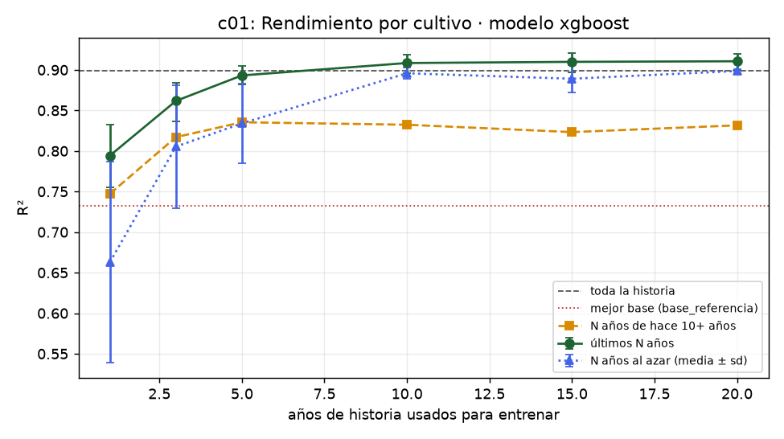
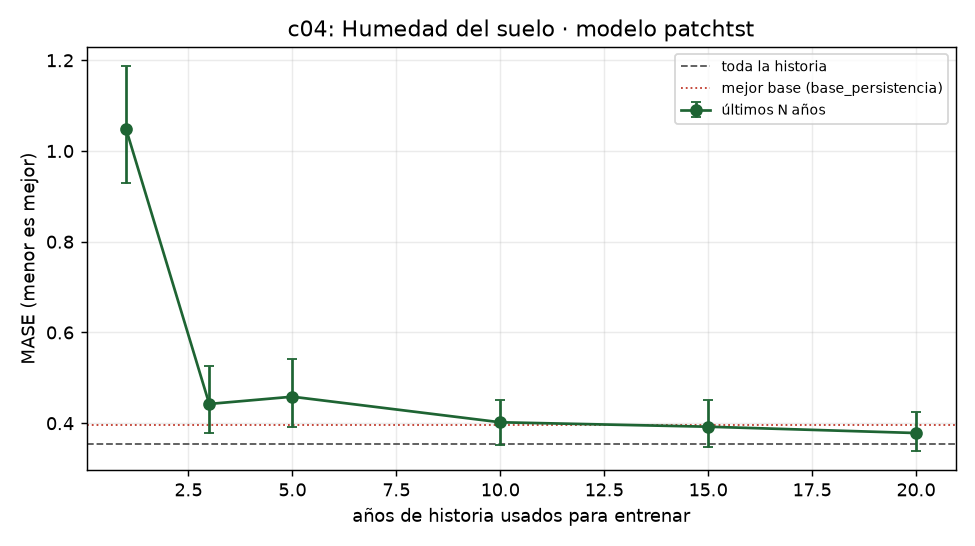
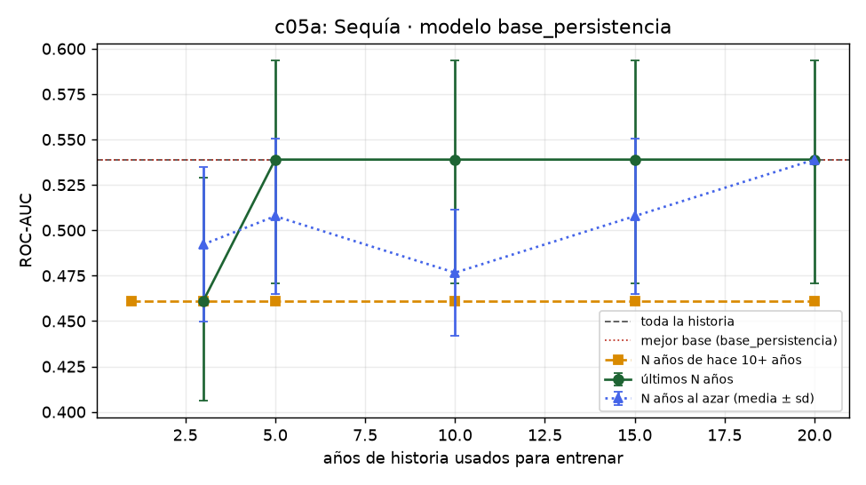
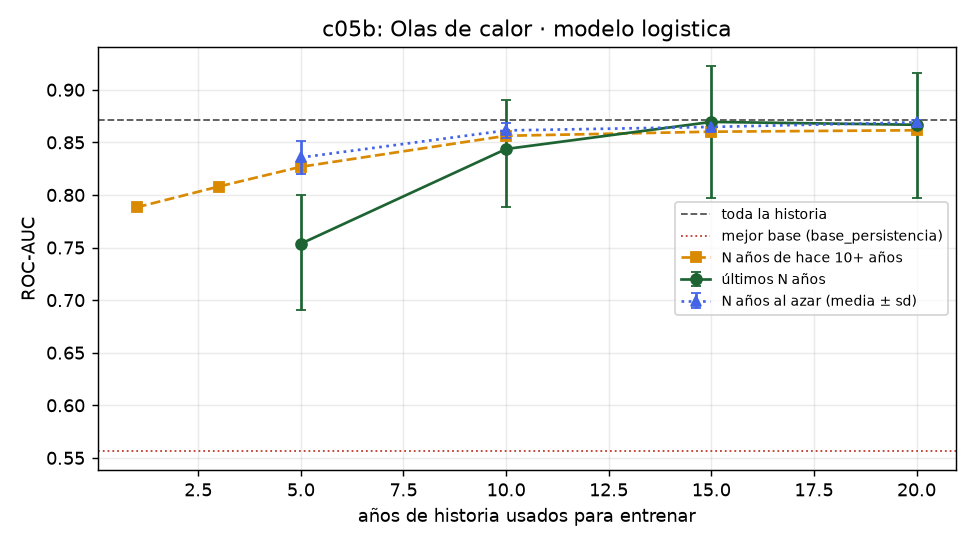
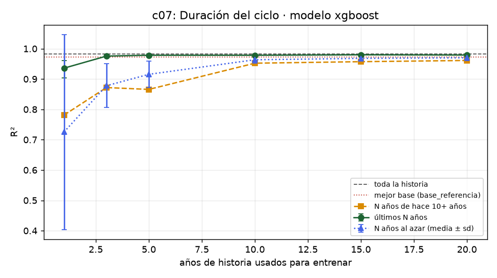
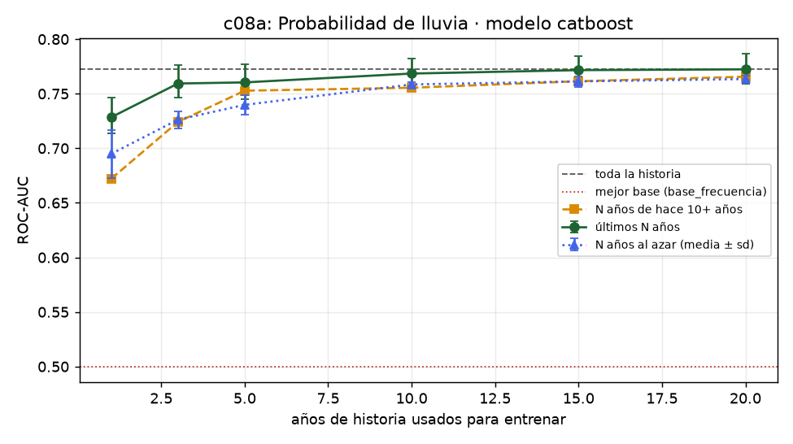
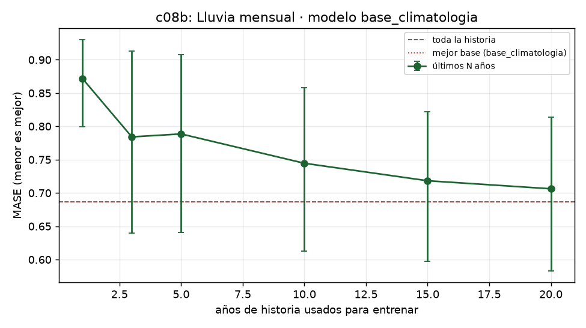
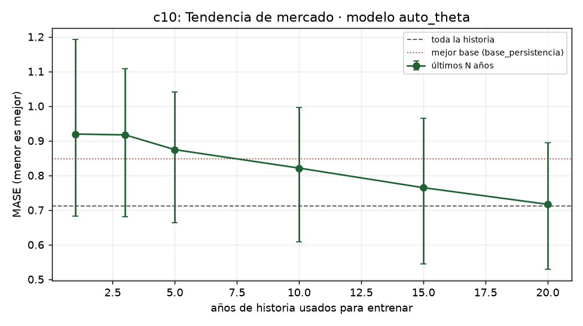

# ¿Cuántos años de historia hacen falta?

Cada modelo desplegado se entrenó de nuevo con ventanas distintas del pasado y se midió **en la misma prueba reciente** (el último 20 % en el tiempo). Así, una diferencia solo puede venir de qué datos vio al entrenar.

**Criterio de «equivalente»:** el intervalo de confianza al 95 % de la diferencia con la historia completa queda por encima de −0.02 (ROC-AUC y R²) o −5% del error (pronósticos). «No concluyente» significa que la prueba es demasiado corta para decidir, no que las ventanas sean iguales.

**Límites:** solo habla de Weld, Colorado y de estos modelos; no dice nada sobre Durango ni sobre el clima futuro. Las definiciones de la etiqueta (umbral de ola de calor, calibración del SPI) se dejaron fijas; `hist_yield` (c01) y los GDD de referencia (c07) se recalcularon con cada ventana. Los pronósticos solo se midieron con «últimos N años».

## Resumen

| Concepto | Modelo | Ventana más corta equivalente | Observación |
|---|---|---|---|
| c01 | xgboost | 5 años |  |
| c04 | patchtst | no hay | ninguna ventana corta alcanza a la historia completa |
| c05a | base_persistencia | 5 años | 1 ventana(s) no concluyentes |
| c05b | logistica | 15 años |  |
| c07 | xgboost | 3 años |  |
| c08a | catboost | 3 años |  |
| c08b | base_climatologia | no hay | ninguna ventana corta alcanza a la historia completa |
| c10 | auto_theta | 20 años |  |

## c01 · Rendimiento por cultivo

Modelo desplegado: **XGBoost (regresión)** (`xgboost`, rol: modelo). Métrica: **R²**.

- Con **toda la historia** (75,748 filas de entrenamiento): 0.899 [0.89–0.91]; la mejor base (base_referencia) saca 0.732.

**Últimos N años** (misma prueba reciente en todas las filas)

| Años | Filas de entrenamiento | R² [IC 95 %] | Skill | Diferencia con toda la historia [IC 95 %] | Veredicto |
|---|---|---|---|---|---|
| 1 | 1,013 | 0.794 [0.76–0.83] | 0.01 | -0.105 [-0.14–-0.08] | PEOR |
| 3 | 3,171 | 0.862 [0.84–0.88] | 0.05 | -0.037 [-0.06–-0.02] | PEOR |
| 5 | 5,504 | 0.893 [0.88–0.90] | 0.10 | -0.006 [-0.01–0.00] | equivalente |
| 10 | 12,709 | 0.908 [0.90–0.92] | 0.14 | 0.010 [0.00–0.01] | mejor |
| 15 | 23,650 | 0.910 [0.90–0.92] | 0.23 | 0.011 [0.01–0.01] | mejor |
| 20 | 35,745 | 0.911 [0.90–0.92] | 0.27 | 0.012 [0.01–0.01] | mejor |

**Lectura:** desde **5 años** de historia el modelo es equivalente a usar todo lo que hay.

**N años de hace 10+ años** (misma prueba reciente en todas las filas)

| Años | Filas de entrenamiento | R² [IC 95 %] | Skill | Diferencia con toda la historia [IC 95 %] | Veredicto |
|---|---|---|---|---|---|
| 1 | 2,015 | 0.747 [0.72–0.77] | -0.10 | -0.152 [-0.18–-0.12] | PEOR |
| 3 | 6,307 | 0.817 [0.80–0.83] | -0.09 | -0.082 [-0.10–-0.07] | PEOR |
| 5 | 10,941 | 0.835 [0.82–0.85] | -0.12 | -0.064 [-0.08–-0.04] | PEOR |
| 10 | 23,036 | 0.832 [0.81–0.85] | -0.16 | -0.067 [-0.09–-0.04] | PEOR |
| 15 | 35,486 | 0.823 [0.80–0.84] | -0.08 | -0.076 [-0.10–-0.05] | PEOR |
| 20 | 48,680 | 0.832 [0.81–0.85] | 0.00 | -0.067 [-0.09–-0.04] | PEOR |

**N años al azar de todo el historial** (media y desviación de las repeticiones; separa «más datos» de «datos recientes»)

| Años | Repeticiones | Media | Desv. | Diferencia media con toda la historia |
|---|---|---|---|---|
| 1 | 5 | 0.663 | 0.124 | -0.236 |
| 3 | 5 | 0.805 | 0.076 | -0.094 |
| 5 | 5 | 0.834 | 0.049 | -0.065 |
| 10 | 5 | 0.896 | 0.007 | -0.003 |
| 15 | 5 | 0.889 | 0.017 | -0.010 |
| 20 | 5 | 0.899 | 0.002 | -0.000 |

## c04 · Humedad del suelo

Modelo desplegado: **PatchTST (pronóstico a 4 semanas)** (`patchtst`, rol: modelo). Métrica: **MASE (menor es mejor)**.

- Con **toda la historia** (3,828 filas de entrenamiento): 0.353 [0.31–0.41]; la mejor base (base_persistencia) saca 0.396.

**Últimos N años** (misma prueba reciente en todas las filas)

| Años | Filas de entrenamiento | MASE (menor es mejor) [IC 95 %] | Skill | Diferencia con toda la historia [IC 95 %] | Veredicto |
|---|---|---|---|---|---|
| 1 | 104 | 1.048 [0.93–1.19] | -1.66 | -1.984 [-2.39–-1.52] | PEOR |
| 3 | 312 | 0.442 [0.38–0.53] | -0.12 | -0.253 [-0.37–-0.17] | PEOR |
| 5 | 520 | 0.458 [0.39–0.54] | -0.16 | -0.299 [-0.48–-0.20] | PEOR |
| 10 | 1,042 | 0.402 [0.35–0.45] | -0.02 | -0.142 [-0.24–-0.06] | PEOR |
| 15 | 1,564 | 0.392 [0.35–0.45] | 0.01 | -0.112 [-0.22–-0.02] | PEOR |
| 20 | 2,086 | 0.378 [0.34–0.42] | 0.05 | -0.072 [-0.14–-0.01] | PEOR |

**Lectura:** ninguna ventana corta alcanza a la historia completa (ninguna ventana corta alcanza a la historia completa).

## c05a · Sequía

Modelo desplegado: **Persistencia: P(sequía en 3 meses | ¿sequía ahora?)** (`base_persistencia`, rol: regla-base). Métrica: **ROC-AUC**.

- Con **toda la historia** (24,870 filas de entrenamiento): 0.539 [0.47–0.59]; la mejor base (base_persistencia) saca 0.539.

**Últimos N años** (misma prueba reciente en todas las filas)

| Años | Filas de entrenamiento | ROC-AUC [IC 95 %] | Skill | Diferencia con toda la historia [IC 95 %] | Veredicto |
|---|---|---|---|---|---|
| 1 | 360 | — | — | 0.000 [0.00–0.00] | equivalente ⚠ prueba distinta |
| 3 | 1,080 | 0.461 [0.41–0.53] | -0.00 | -0.078 [-0.19–0.06] | no concluyente |
| 5 | 1,800 | 0.539 [0.47–0.59] | 0.00 | 0.000 [0.00–0.00] | equivalente |
| 10 | 3,600 | 0.539 [0.47–0.59] | 0.00 | 0.000 [0.00–0.00] | equivalente |
| 15 | 5,400 | 0.539 [0.47–0.59] | 0.00 | 0.000 [0.00–0.00] | equivalente |
| 20 | 7,200 | 0.539 [0.47–0.59] | 0.00 | 0.000 [0.00–0.00] | equivalente |

**Lectura:** desde **5 años** de historia el modelo es equivalente a usar todo lo que hay (1 ventana(s) no concluyentes).

**N años de hace 10+ años** (misma prueba reciente en todas las filas)

| Años | Filas de entrenamiento | ROC-AUC [IC 95 %] | Skill | Diferencia con toda la historia [IC 95 %] | Veredicto |
|---|---|---|---|---|---|
| 1 | 360 | 0.461 [0.41–0.53] | -0.08 | -0.078 [-0.19–0.06] | no concluyente |
| 3 | 1,080 | 0.461 [0.41–0.53] | -0.07 | -0.078 [-0.19–0.06] | no concluyente |
| 5 | 1,800 | 0.461 [0.41–0.53] | -0.05 | -0.078 [-0.19–0.06] | no concluyente |
| 10 | 3,600 | 0.461 [0.41–0.53] | -0.03 | -0.078 [-0.19–0.06] | no concluyente |
| 15 | 5,400 | 0.461 [0.41–0.53] | -0.02 | -0.078 [-0.19–0.06] | no concluyente |
| 20 | 7,200 | 0.461 [0.41–0.53] | -0.03 | -0.078 [-0.19–0.06] | no concluyente |

**N años al azar de todo el historial** (media y desviación de las repeticiones; separa «más datos» de «datos recientes»)

| Años | Repeticiones | Media | Desv. | Diferencia media con toda la historia |
|---|---|---|---|---|
| 1 | 5 | — | — | -0.031 |
| 3 | 5 | 0.492 | 0.043 | -0.047 |
| 5 | 5 | 0.508 | 0.043 | -0.031 |
| 10 | 5 | 0.477 | 0.035 | -0.062 |
| 15 | 5 | 0.508 | 0.043 | -0.031 |
| 20 | 5 | 0.539 | 0.000 | 0.000 |

⚠ 6 fila(s) tuvieron una prueba distinta a la de toda la historia y no cuentan para el veredicto.

## c05b · Olas de calor

Modelo desplegado: **Regresión logística** (`logistica`, rol: modelo). Métrica: **ROC-AUC**.

- Con **toda la historia** (11,322 filas de entrenamiento): 0.871 [0.81–0.92]; la mejor base (base_persistencia) saca 0.557.

**Últimos N años** (misma prueba reciente en todas las filas)

| Años | Filas de entrenamiento | ROC-AUC [IC 95 %] | Skill | Diferencia con toda la historia [IC 95 %] | Veredicto |
|---|---|---|---|---|---|
| 1 | 306 | — | — | — | sin intervalo ⚠ prueba distinta |
| 3 | 918 | — | — | — | sin intervalo ⚠ prueba distinta |
| 5 | 1,530 | 0.754 [0.69–0.80] | 0.07 | -0.117 [-0.18–-0.05] | PEOR |
| 10 | 3,060 | 0.844 [0.79–0.89] | 0.21 | -0.027 [-0.05–-0.01] | PEOR |
| 15 | 4,590 | 0.869 [0.80–0.92] | 0.24 | -0.002 [-0.01–0.00] | equivalente |
| 20 | 6,120 | 0.867 [0.80–0.92] | 0.24 | -0.004 [-0.01–-0.00] | equivalente |

**Lectura:** desde **15 años** de historia el modelo es equivalente a usar todo lo que hay.

**N años de hace 10+ años** (misma prueba reciente en todas las filas)

| Años | Filas de entrenamiento | ROC-AUC [IC 95 %] | Skill | Diferencia con toda la historia [IC 95 %] | Veredicto |
|---|---|---|---|---|---|
| 1 | 306 | 0.788 [0.73–0.83] | -0.05 | -0.083 [-0.13–-0.03] | PEOR |
| 3 | 918 | 0.808 [0.76–0.86] | 0.03 | -0.063 [-0.08–-0.04] | PEOR |
| 5 | 1,530 | 0.827 [0.77–0.88] | 0.10 | -0.044 [-0.06–-0.02] | PEOR |
| 10 | 3,060 | 0.856 [0.79–0.90] | 0.20 | -0.015 [-0.02–-0.01] | PEOR |
| 15 | 4,590 | 0.860 [0.80–0.91] | 0.21 | -0.011 [-0.02–-0.00] | equivalente |
| 20 | 6,120 | 0.862 [0.80–0.91] | 0.21 | -0.009 [-0.01–-0.00] | equivalente |

**N años al azar de todo el historial** (media y desviación de las repeticiones; separa «más datos» de «datos recientes»)

| Años | Repeticiones | Media | Desv. | Diferencia media con toda la historia |
|---|---|---|---|---|
| 1 | 8 | — | — | — |
| 3 | 8 | — | — | — |
| 5 | 8 | 0.836 | 0.016 | -0.035 |
| 10 | 8 | 0.861 | 0.007 | -0.010 |
| 15 | 8 | 0.865 | 0.003 | -0.006 |
| 20 | 8 | 0.869 | 0.002 | -0.002 |

⚠ 15 fila(s) tuvieron una prueba distinta a la de toda la historia y no cuentan para el veredicto.

## c07 · Duración del ciclo

Modelo desplegado: **XGBoost (regresión)** (`xgboost`, rol: modelo). Métrica: **R²**.

- Con **toda la historia** (744 filas de entrenamiento): 0.983 [0.98–0.99]; la mejor base (base_referencia) saca 0.973.

**Últimos N años** (misma prueba reciente en todas las filas)

| Años | Filas de entrenamiento | R² [IC 95 %] | Skill | Diferencia con toda la historia [IC 95 %] | Veredicto |
|---|---|---|---|---|---|
| 1 | 35 | 0.936 [0.90–0.96] | -0.55 | -0.047 [-0.08–-0.02] | PEOR |
| 3 | 104 | 0.976 [0.97–0.98] | 0.04 | -0.008 [-0.01–-0.01] | equivalente |
| 5 | 155 | 0.978 [0.97–0.98] | 0.10 | -0.005 [-0.01–-0.00] | equivalente |
| 10 | 259 | 0.978 [0.97–0.98] | 0.10 | -0.004 [-0.01–-0.00] | equivalente |
| 15 | 363 | 0.980 [0.97–0.98] | 0.13 | -0.003 [-0.00–-0.00] | equivalente |
| 20 | 463 | 0.979 [0.97–0.98] | 0.12 | -0.004 [-0.00–-0.00] | equivalente |

**Lectura:** desde **3 años** de historia el modelo es equivalente a usar todo lo que hay.

**N años de hace 10+ años** (misma prueba reciente en todas las filas)

| Años | Filas de entrenamiento | R² [IC 95 %] | Skill | Diferencia con toda la historia [IC 95 %] | Veredicto |
|---|---|---|---|---|---|
| 1 | 21 | 0.781 [0.74–0.82] | -1.86 | -0.202 [-0.24–-0.16] | PEOR |
| 3 | 63 | 0.872 [0.84–0.91] | -1.19 | -0.111 [-0.14–-0.08] | PEOR |
| 5 | 104 | 0.866 [0.83–0.91] | -1.24 | -0.117 [-0.15–-0.08] | PEOR |
| 10 | 204 | 0.952 [0.92–0.98] | -0.33 | -0.030 [-0.06–-0.01] | PEOR |
| 15 | 295 | 0.957 [0.93–0.98] | -0.26 | -0.025 [-0.05–-0.01] | PEOR |
| 20 | 378 | 0.961 [0.93–0.98] | -0.20 | -0.021 [-0.05–-0.01] | PEOR |

**N años al azar de todo el historial** (media y desviación de las repeticiones; separa «más datos» de «datos recientes»)

| Años | Repeticiones | Media | Desv. | Diferencia media con toda la historia |
|---|---|---|---|---|
| 1 | 8 | 0.725 | 0.322 | -0.257 |
| 3 | 8 | 0.878 | 0.072 | -0.105 |
| 5 | 8 | 0.915 | 0.044 | -0.067 |
| 10 | 8 | 0.963 | 0.011 | -0.019 |
| 15 | 8 | 0.968 | 0.009 | -0.015 |
| 20 | 8 | 0.970 | 0.010 | -0.013 |

## c08a · Probabilidad de lluvia

Modelo desplegado: **CatBoost (clasificación)** (`catboost`, rol: modelo). Métrica: **ROC-AUC**.

- Con **toda la historia** (26,970 filas de entrenamiento): 0.773 [0.76–0.79]; la mejor base (base_frecuencia) saca 0.500.

**Últimos N años** (misma prueba reciente en todas las filas)

| Años | Filas de entrenamiento | ROC-AUC [IC 95 %] | Skill | Diferencia con toda la historia [IC 95 %] | Veredicto |
|---|---|---|---|---|---|
| 1 | 730 | 0.728 [0.71–0.75] | 0.03 | -0.044 [-0.05–-0.04] | PEOR |
| 3 | 2,192 | 0.759 [0.75–0.78] | 0.12 | -0.013 [-0.02–-0.01] | equivalente |
| 5 | 3,652 | 0.760 [0.74–0.78] | 0.14 | -0.012 [-0.02–-0.01] | equivalente |
| 10 | 7,306 | 0.768 [0.75–0.78] | 0.16 | -0.004 [-0.01–0.00] | equivalente |
| 15 | 10,958 | 0.772 [0.76–0.78] | 0.17 | -0.001 [-0.00–0.00] | equivalente |
| 20 | 14,610 | 0.772 [0.76–0.79] | 0.17 | -0.000 [-0.00–0.00] | equivalente |

**Lectura:** desde **3 años** de historia el modelo es equivalente a usar todo lo que hay.

**N años de hace 10+ años** (misma prueba reciente en todas las filas)

| Años | Filas de entrenamiento | ROC-AUC [IC 95 %] | Skill | Diferencia con toda la historia [IC 95 %] | Veredicto |
|---|---|---|---|---|---|
| 1 | 730 | 0.672 [0.65–0.70] | -0.11 | -0.101 [-0.12–-0.08] | PEOR |
| 3 | 2,190 | 0.724 [0.71–0.74] | 0.08 | -0.048 [-0.06–-0.04] | PEOR |
| 5 | 3,652 | 0.753 [0.74–0.77] | 0.13 | -0.020 [-0.03–-0.01] | PEOR |
| 10 | 7,304 | 0.755 [0.74–0.77] | 0.14 | -0.017 [-0.02–-0.01] | PEOR |
| 15 | 10,956 | 0.761 [0.75–0.78] | 0.15 | -0.011 [-0.02–-0.00] | equivalente |
| 20 | 14,610 | 0.766 [0.75–0.78] | 0.16 | -0.007 [-0.01–-0.00] | equivalente |

**N años al azar de todo el historial** (media y desviación de las repeticiones; separa «más datos» de «datos recientes»)

| Años | Repeticiones | Media | Desv. | Diferencia media con toda la historia |
|---|---|---|---|---|
| 1 | 5 | 0.695 | 0.022 | -0.078 |
| 3 | 5 | 0.726 | 0.008 | -0.046 |
| 5 | 5 | 0.740 | 0.009 | -0.033 |
| 10 | 5 | 0.759 | 0.002 | -0.014 |
| 15 | 5 | 0.761 | 0.005 | -0.011 |
| 20 | 5 | 0.763 | 0.003 | -0.009 |

## c08b · Lluvia mensual

Modelo desplegado: **Climatología mensual (promedio de cada mes)** (`base_climatologia`, rol: regla-base). Métrica: **MASE (menor es mejor)**.

- Con **toda la historia** (880 filas de entrenamiento): 0.686 [0.56–0.79]; la mejor base (base_climatologia) saca 0.686.

**Últimos N años** (misma prueba reciente en todas las filas)

| Años | Filas de entrenamiento | MASE (menor es mejor) [IC 95 %] | Skill | Diferencia con toda la historia [IC 95 %] | Veredicto |
|---|---|---|---|---|---|
| 1 | 24 | 0.872 [0.80–0.93] | -0.02 | -0.271 [-0.53–-0.11] | PEOR |
| 3 | 70 | 0.784 [0.64–0.91] | 0.00 | -0.143 [-0.23–-0.05] | PEOR |
| 5 | 120 | 0.789 [0.64–0.91] | 0.00 | -0.149 [-0.21–-0.10] | PEOR |
| 10 | 238 | 0.745 [0.61–0.86] | 0.00 | -0.085 [-0.13–-0.04] | PEOR |
| 15 | 358 | 0.718 [0.60–0.82] | 0.00 | -0.046 [-0.08–-0.02] | PEOR |
| 20 | 478 | 0.706 [0.58–0.81] | 0.00 | -0.029 [-0.07–0.00] | no concluyente |

**Lectura:** ninguna ventana corta alcanza a la historia completa (ninguna ventana corta alcanza a la historia completa).

## c10 · Tendencia de mercado

Modelo desplegado: **AutoTheta (pronóstico a 6 meses)** (`auto_theta`, rol: modelo). Métrica: **MASE (menor es mejor)**.

- Con **toda la historia** (2,471 filas de entrenamiento): 0.711 [0.51–0.90]; la mejor base (base_persistencia) saca 0.848.

**Últimos N años** (misma prueba reciente en todas las filas)

| Años | Filas de entrenamiento | MASE (menor es mejor) [IC 95 %] | Skill | Diferencia con toda la historia [IC 95 %] | Veredicto |
|---|---|---|---|---|---|
| 1 | 84 | 0.919 [0.68–1.19] | -0.09 | -0.295 [-0.55–-0.07] | PEOR |
| 3 | 252 | 0.917 [0.68–1.11] | -0.08 | -0.285 [-0.47–-0.17] | PEOR |
| 5 | 420 | 0.874 [0.66–1.04] | -0.03 | -0.228 [-0.46–-0.09] | PEOR |
| 10 | 840 | 0.821 [0.61–1.00] | 0.04 | -0.147 [-0.27–-0.05] | PEOR |
| 15 | 1,260 | 0.765 [0.54–0.97] | 0.09 | -0.080 [-0.13–-0.02] | PEOR |
| 20 | 1,673 | 0.717 [0.53–0.90] | 0.15 | -0.007 [-0.04–0.01] | equivalente |

**Lectura:** desde **20 años** de historia el modelo es equivalente a usar todo lo que hay.

